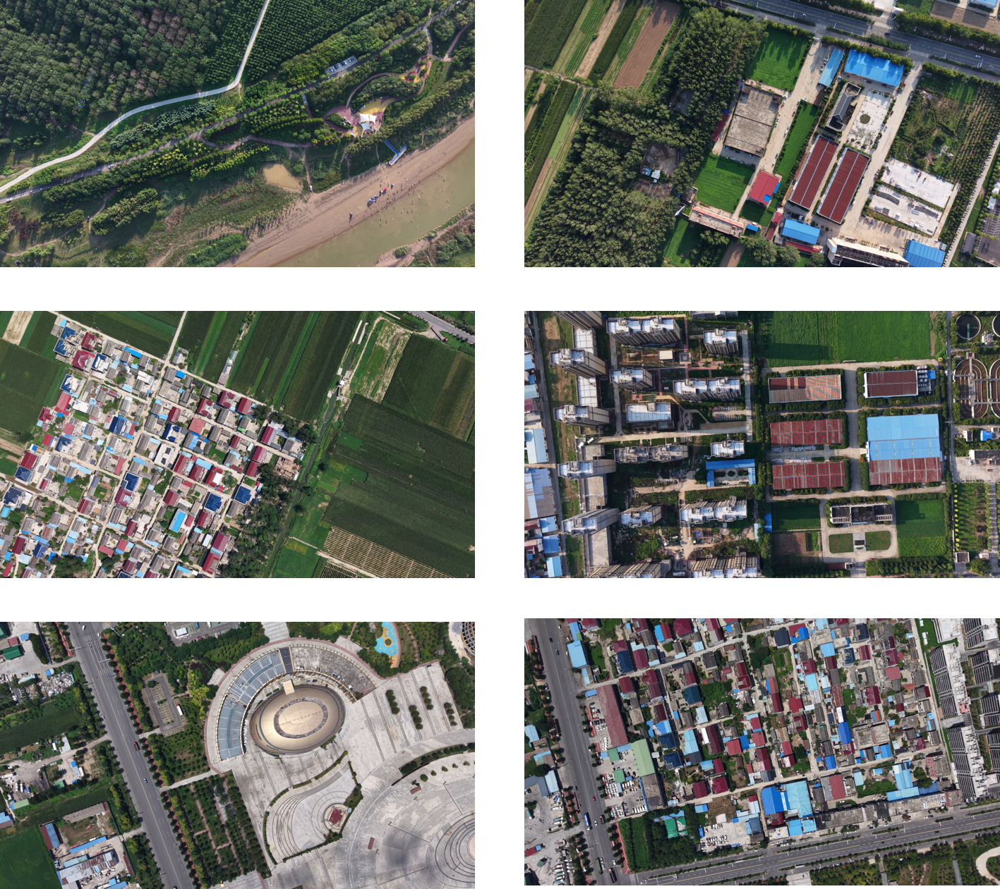

#  
GenHNR: Significantly Boost the Retrieval Accuracy of Your UVGL Method

This repository contains the dataset and the code for our paper **GenHNR: A Generalizable Hard Negative Refinement Framework for UAV-View Geo-Localization**. Thank you for your kindly attention.
## 1. XIHUA-Visloc Dataset
We construct a new real-world continuous-scene UAV localization dataset, **XIHUA-Visloc**, following the design of XIAN-Visloc. Unlike XIAN-Visloc, which primarily covers urban areas, XIHUA-Visloc comprises **town environments** in [**Xihua County**](https://www.google.com/maps/search/?api=1&query=Xihua%20County%2C%20Zhoukou%2C%20Henan%2C%20China), China. These scenes mainly feature dense, low-rise buildings and sparsely distributed farmland. XIHUA-Visloc contains eight flight sequences captured by a DJI Air 3S UAV, with a total flight distance of 42.32 km and a flight altitude of 300–350 m. The dataset consists of 3,555 UAV images with a resolution of $3840 \times 2160$ pixels. Four regional satellite maps were obtained from Google Earth, covering a total area of 55.09 $\mathrm{km}^{2}$. The first six flight sequences are used for training, while the remaining two are reserved for testing.

  

## 2. Data preparation for XIHUA-Visloc
